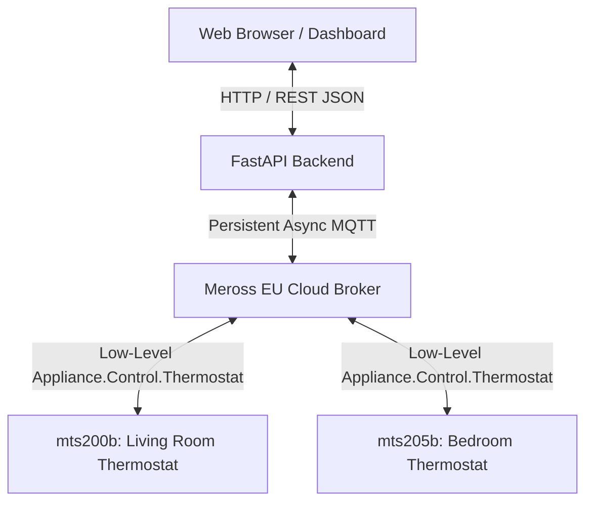

<div align="center">

# 🌡️ Meross Thermostat Smart Scheduler

**A fast, modern local web application to view, edit, and bulk-sync weekly heating schedules for Meross Wi-Fi thermostats (`mts200b` and `mts205b`).**

Overcomes the tedious day-by-day mobile app editing with tactile drag-and-drop bars, bulk replication, and cross-thermostat cloning.

---

[](https://www.python.org/)
[](https://fastapi.tiangolo.com/)
[](https://tailwindcss.com/)
[](https://alpinejs.dev/)
[](https://github.com/albertogeniola/MerossIot)

</div>

---

## ⚡ Highlights & Features

- 🎛️ **Tactile Equalizer Bar Editor:** Adjust heating temperatures simply by **clicking and dragging bars vertically** with your mouse (`+0.5°C` / `-0.5°C`).
- ↔️ **Draggable Time Boundaries:** Click and drag divider handles left or right to re-apportion time intervals (snaps smoothly to 15-minute increments).
- 🔄 **Bulk Day-to-Day Copying:**
  - **Copy to Weekdays (Tue–Fri):** Set Monday once and propagate it to all work days with one click.
  - **Copy to Weekend:** Duplicate Saturday schedule to Sunday.
  - **Copy to All Days:** Instant replication across the whole week.
- 🔁 **Thermostat-to-Thermostat Cloning:** One-click cloning of the entire 7-day schedule between thermostats (e.g. from `mts200b` to `mts205b`).
- ✋ **Dual Control Modes:**
  - **Schedule (Auto):** Target temperature follows the 7-day programmed schedule.
  - **Manual Mode:** Override schedule with a direct setpoint (click target box or use `+` / `-`).
- 🔒 **Zero Gap Guarantee:** Strictly validates and enforces continuous 24-hour coverage (`1440` minutes) and hardware constraints (max 8 sections per day).
- 🇪🇺 **Native European Cloud Support:** Configured for EU endpoints (`https://iotx-eu.meross.com`) with clean async connection lifecycle (never spams login).

---

## 🏛️ System Architecture



---

## 🚀 Quick Start

### 1. Prerequisites
- **Python:** 3.10 or newer (tested with Python 3.14).
- A Meross cloud account with one or more online thermostats (`mts200b` / `mts205b`).

### 2. Setup Virtual Environment

```bash
# Clone the repository
git clone https://github.com/your-username/110-meross.git
cd 110-meross

# Create and activate virtual environment
python3 -m venv .venv
source .venv/bin/activate

# Install required dependencies
pip install -r requirements.txt
```

### 3. Configure Credentials

Copy `.env.example` to `.env` and fill in your Meross account details:

```bash
cp .env.example .env
```

Edit `.env`:
```env
# Meross Cloud Account Credentials
MEROSS_EMAIL=your_email@example.com
MEROSS_PASSWORD=your_password

# European Cloud Endpoint
MEROSS_API_BASE_URL=https://iotx-eu.meross.com
```

> [!NOTE]
> `.env` contains your personal credentials and is ignored by `.gitignore`. Never commit `.env` to Git.

### 4. Run Diagnostic Discovery (Optional)

Test connectivity and inspect your hardware's abilities and current schedule:

```bash
.venv/bin/python scripts/test_connection.py
```

### 5. Launch the Web Application

Start the local FastAPI application:

```bash
.venv/bin/uvicorn app.main:app --port 8000 --host 127.0.0.1
```

Now open your browser at:
👉 **[http://localhost:8000](http://localhost:8000)**

---

## 📖 How to Use

### 1. Switching Operating Modes
On each thermostat card at the top, select your preferred control mode:
- **`Schedule` (Auto):** Target temperature follows the programmed schedule for the current day and time.
- **`Manual`:** Bypasses schedule and locks the thermostat to a custom setpoint.

### 2. Direct Target Temperature Adjustment
- In **Manual mode**, the **Target Box** turns amber.
- Click directly on the temperature number to type a new target (e.g. `17.5`), or use the **`-`** and **`+`** stepper buttons.
- The change is instantly transmitted to the physical thermostat.

### 3. Drag-to-Adjust Schedule Bars
- **Adjust Temperature:** Click on any colored bar in the weekly grid and **drag your mouse UP** to raise the temperature or **DOWN** to lower it.
- **Adjust Interval Times:** Hover between any two time blocks to see the vertical divider handle. **Click & drag LEFT or RIGHT** to move the transition time (15-minute steps).
- **Split Slot (`+ Split Slot`):** Divides the longest interval into two slots (up to 8 slots max per day).
- **Delete Slot:** Hover over a slot and click the small `×` icon to merge it with its adjacent neighbor.

### 4. Bulk Replication
- **Copy to Weekdays (Tue–Fri):** Customize Monday, then click **"Copy to Weekdays"** to replicate it across Tuesday, Wednesday, Thursday, and Friday.
- **Copy to Sunday:** Customize Saturday, then click **"Copy to Sunday"**.
- **Copy to All Days:** Replicate any day across all other 6 days.

### 5. Thermostat-to-Thermostat Cloning
- In the top banner, click **"Clone to [Target Thermostat]"**.
- Confirm the prompt to immediately copy the full 7-day schedule to the target thermostat over MQTT.

### 6. Saving Changes
Whenever any schedule modification is made, a **Sticky Save Bar** appears at the bottom:
- Click **"Discard Changes"** to reset to the last fetched schedule.
- Click **"Save to Thermostat"** to validate with Pydantic and push the schedule via Meross MQTT.

---

## 📂 Repository Structure

```text
├── .env.example              # Sample environment configuration
├── .gitignore                # Protects credentials and virtualenv
├── GEMINI.md                 # Context & strict architecture guidelines
├── PLAN.md                   # Iterative 4-phase implementation plan
├── requirements.txt          # Python dependencies
├── app/
│   ├── main.py               # FastAPI application with lifespan management
│   ├── meross_service.py     # Singleton MerossManager & device client
│   └── schemas.py            # Pydantic models & bidirectional schedule parsers
├── scripts/
│   ├── test_connection.py    # Hardware discovery & abilities inspector
│   └── test_schedule_write.py# Safe CLI test for schedule read/write cycle
└── static/
    └── index.html            # Single Page App (Tailwind CSS + Alpine.js)
```

---

## 🔌 API Reference

| Method | Endpoint | Description |
| :--- | :--- | :--- |
| `GET` | `/api/devices` | Lists all discovered thermostats with ambient/target temps & status. |
| `GET` | `/api/devices/{uuid}/schedule` | Retrieves the 7-day schedule formatted into human-readable slots. |
| `POST` | `/api/devices/{uuid}/schedule` | Pushes a complete 7-day schedule to the thermostat. |
| `POST` | `/api/devices/{uuid}/clone-to/{target_uuid}` | Clones schedule from source thermostat to target thermostat. |
| `POST` | `/api/devices/{uuid}/mode` | Sets mode (`3` for Schedule, `4` for Manual). |
| `POST` | `/api/devices/{uuid}/target-temperature` | Sets manual target temperature in `°C`. |

---

## 🛡️ License

MIT License. Developed for local smart home scheduling.
